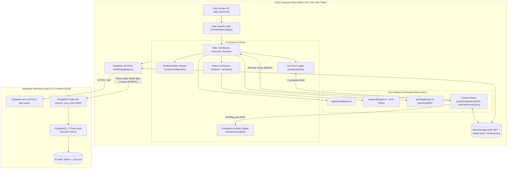

> **Reference Pack Metadata**
> - **App Name:** Best Damn Weight Lifting Tracker Ever (`weightliftinglog` / UI Banner: *Best Damn Workout Tracker Ever*)
> - **Git Commit SHA & Branch:** `9a6f80e` (`main`) + Phase 1 Working Tree Updates — Base Commit `2026-09-30 18:54:32 -0500`
> - **Snapshot Date:** `2026-11-13`
> - **File Scope:** High-level product summary, target platforms, exact framework/library versions, runtime & offline/in-gym persistence behavior, source directory map, and system data-flow architecture.

# 01 — Architecture & Tech Stack

## 1. Product Summary & Target Platforms

**Best Damn Weight Lifting Tracker Ever** (`WeightLiftingLog`) is a cross-platform hypertrophy and strength training planner, gym-floor set logger, and exercise-science analytics application. Its core domain model centers on:
- **Fractional Volumetric Split Planning ("Sandbox Mode"):** Users build 3-to-7-day training splits across multi-cycle blocks while previewing weekly muscle-group set volume weighted at `1.0` (primary) and `0.5` (secondary).
- **Sequential Cycle Rotation:** Rather than locking workouts to calendar weekdays, an active routine advances sequentially through `Day 1 .. N` of `Cycle 1`, then wraps to `Day 1` of `Cycle 2`.
- **Low-Friction Gym Floor Execution:** Supports standalone lifts and multi-exercise supersets/giant sets, Set-1-to-Set-N value cloning, previous-session ghost text, smart rest countdown timers, and "Fresh Memory" `Next Target Weight` capture.
- **Exercise Science Analytics:** Tracks Epley estimated 1RM curves, session tonnage and density (`lbs/min`), 7-muscle-group MAV (`12–20` sets/week) radar comparisons, 12-week consistency heatmaps, and cycle-over-cycle progression diffs.

### Target Platforms
Built as a **universal Expo / React Native single codebase** targeting:
1. **Web / Mobile Web SPA:** Exported statically via `npx expo export -p web` (`dist/` output) using `react-native-web` and Metro. Includes explicit `Platform.OS === 'web'` branches for confirmation dialogs (`window.confirm` / `window.alert`), haptics try/catch fallbacks, and browser Blob CSV downloads. No Service Worker or PWA manifest offline caching is configured.
2. **iOS Native (Phone & Tablet):** Configured in `app.json` with portrait orientation, `supportsTablet: true`, and custom URL scheme `weightliftinglog://`.
3. **Android Native:** Configured with adaptive icons and `predictiveBackGestureEnabled: false`.

---

## 2. Exact Tech Stack & Version Inventory

All versions below reflect the exact declarations in `package.json`, `app.json`, and `supabase/config.toml` as of the `2026-11-13` Phase 1 working tree on `9a6f80e`.

| Layer | Technology / Package | Version | Role & Implementation Notes |
| :--- | :--- | :--- | :--- |
| **Core Runtime** | `expo` | `~57.0.4` | Universal app runtime & CLI (`main: "expo-router/entry"`) |
| **UI Framework** | `react` / `react-dom` | `19.2.3` | Component model & web DOM renderer |
| **Native Runtime** | `react-native` | `0.86.0` | iOS & Android native primitives |
| **Web Adapter** | `react-native-web` | `^0.21.2` | Maps React Native primitives to DOM elements |
| **Routing** | `expo-router` | `~57.0.4` | File-based stack, tab, and modal navigation (`16` files in `app/`: `3` layouts + `13` screens) |
| **Navigation Deps** | `react-native-screens` / `react-native-safe-area-context` | `4.25.2` / `~5.7.0` | Native screen containers & safe-area inset handling |
| **Language** | `typescript` | `~6.0.3` | Strict mode enabled (`"strict": true`, extends `expo/tsconfig.base`) |
| **Styling** | `nativewind` + `tailwindcss` | `^4.2.6` / `^3.3.2` | Utility-first styling via Babel `jsxImportSource: "nativewind"` & Metro `withNativeWind` (`global.css`). Dark-slate palette across JSX and `"userInterfaceStyle": "dark"` in `app.json`. |
| **Icons** | `lucide-react-native` | `^1.24.0` | Vector iconography across all screens |
| **Charting** | `react-native-svg` | `15.15.4` | Powers custom SVG visualizations (`LineChart`, `BarChart`, `RadarChart`, `Sparkline`, and Dashboard progress rings). No third-party chart library is used. |
| **Device APIs** | `expo-keep-awake`, `expo-haptics`, `expo-linking`, `expo-constants`, `expo-status-bar` | `~57.0.2` / `~57.0.x` | Screen wake-lock during active sessions (`expo-keep-awake`), preference-gated tactile feedback (`expo-haptics`), and deep-linking |
| **State Management** | `zustand` (`persist` middleware) + React Hooks | `^5.0.14` | **2 persisted Zustand stores** in `src/store/` (`useActiveWorkoutStore`, `usePreferencesStore`), plus screen-local React hooks for PostgREST fetches. |
| **Backend / BaaS** | `@supabase/supabase-js` + `react-native-url-polyfill` | `^2.110.3` / `^3.0.0` | Direct client-to-Supabase Auth (`auth/v1`) & PostgREST (`rest/v1`) queries. **0** custom API routes, Server Actions, or Edge Functions. |
| **Database** | PostgreSQL (via Supabase) | `17` | `8` public tables, `3` custom enums, `7` SQL migrations, Row-Level Security (RLS) enforced on all tables, PostgREST `max_rows = 1000`. |
| **Local Storage** | `@react-native-async-storage/async-storage` | `^3.1.1` | Persists **3 namespaces**: `supabase.auth` JWT session tokens, active/pending workout drafts (`weightlifting-active-workout-v1`), and user preferences (`weightlifting-preferences-v1`). |
| **Auth** | Supabase Auth (GoTrue) | Built-in | Email + password sign-up/sign-in (`jwt_expiry = 3600`, refresh token rotation enabled). OAuth/MFA/SMS disabled. |
| **Hosting / CI** | Static Web Export (`npx expo export -p web`) | Verified (`dist/`) | Web bundle exports cleanly (`2,672` modules); no `eas.json`, `vercel.json`, `netlify.toml`, or `.github/workflows` exist in repo. |
| **Automated Tests** | None | `0` tests | No test runner (Jest/Vitest/Playwright) installed; `0` automated unit/integration/E2E tests (`1` manual SQL RLS snippet). |

---

## 3. Runtime, Offline / In-Gym Behavior & Persistence Architecture

Because gym environments frequently suffer from dead zones and intermittent cellular/Wi-Fi connectivity, understanding the exact persistence lifecycle is critical before planning new features:

### Hybrid Online-First Reads with Crash-Safe Offline Workout Drafts
Historical queries, routine management, and analytics fetch directly from Supabase PostgREST on mount or screen focus (`useFocusEffect`)—there is no full offline replica database (no SQLite/WatermelonDB). However, **all in-progress workouts and pending completions persist locally in `AsyncStorage` via Zustand (`useActiveWorkoutStore`)**, protecting gym-floor sessions against crashes, OS eviction, browser refreshes, and cellular dead zones.

### Lifecycle Phase Breakdown
1. **Boot & Authentication (`app/_layout.tsx`, `src/lib/supabase.ts`):**
   - `supabase.auth` persists the user's JWT and refresh token in `AsyncStorage` (`autoRefreshToken: true`, `persistSession: true`, `detectSessionInUrl: false`).
   - Both Zustand stores rehydrate asynchronously from `AsyncStorage` and expose `_hasHydrated` flags so screens never overwrite or skip an existing workout draft during startup.
2. **Starting or Resuming a Workout (`app/workout/active.tsx`):**
   - If `useActiveWorkoutStore` holds a hydrated draft matching the signed-in `userId` (same routine or resumed from Dashboard), `ActiveWorkoutScreen` restores all sets, completion states, `startedAtTimestamp`, and running `restTimerEndTimestamp` immediately with zero data loss.
   - Starting a fresh session requires live connectivity once on mount to query the active `routines` graph (`routine_days` -> `routine_exercises` -> `exercises`) and historical `session_exercises` / `session_sets` for pre-filling weights and reps.
3. **Mid-Workout Logging (Zero-Network Crash-Safe Draft + Wake-Lock + Wall-Clock Timer):**
   - Every set edit, completion checkbox toggle, set/round addition, Next Target Weight edit, and rest timer change commits directly into `useActiveWorkoutStore` (`AsyncStorage` key `'weightlifting-active-workout-v1'`) with zero network calls.
   - `KeepAwake.activateKeepAwakeAsync` keeps the screen awake while `ActiveWorkoutScreen` is focused (safely guarded for web/hidden tabs and foreground transitions).
   - Rest countdowns store an absolute `restTimerEndTimestamp` and compute remaining time via `Math.max(0, Math.ceil((restTimerEndTimestamp - Date.now()) / 1000))`, reconciling immediately on `AppState` `'active'` transitions so screen locking or app switching never freezes or drifts the timer.
   - Force-closing or navigating back to Dashboard surfaces a **Resume In-Progress Workout** banner in `app/(tabs)/index.tsx`.
4. **Workout Completion & Offline Sync Recovery (`app/workout/complete.tsx`):**
   - Tapping **Finish Workout** marks `syncStatus: 'pending_sync'` inside `useActiveWorkoutStore` and routes cleanly to `/workout/complete` with no large JSON route parameters.
   - `WorkoutCompleteScreen` executes idempotent PostgREST writes (persisting `savedSessionId` in the store before writing `session_exercises` / `session_sets`, deleting/re-inserting sets cleanly on retries, updating `routine_exercises.target_weight`, and advancing `routines.current_day` / `current_cycle`).
   - The active workout draft is cleared **only** when the user confirms **Discard Workout** or when **all** PostgREST writes complete cleanly. If a dead-zone network failure occurs and the user taps **Return Anyway**, `syncStatus: 'pending_sync'` remains saved in `AsyncStorage` and Dashboard renders an amber **Unsaved Workout Ready to Sync** retry banner routing back to `/workout/complete`.

---

## 4. Source Directory Map

```text
WeightLiftingLog/
├── app/                              # Expo Router file-based navigation (3 layouts + 13 screens)
│   ├── _layout.tsx                   # Root Stack navigator + Supabase Auth session gate
│   ├── settings.tsx                  # Modal screen: display name update, persisted timer/haptics prefs, sign-out
│   ├── (auth)/
│   │   ├── _layout.tsx               # Unauthenticated Stack wrapper
│   │   └── login.tsx                 # Email/password sign-in & sign-up form
│   ├── (tabs)/
│   │   ├── _layout.tsx               # Bottom Tab bar (Dashboard, Exercises, Routines)
│   │   ├── index.tsx                 # Dashboard: KPIs, Resume/Sync banners, Hero Workout card, 1RM sparklines, volume ring
│   │   ├── exercises.tsx             # Exercise Library: search by name/muscle, muscle badges
│   │   └── routines.tsx              # Routines manager: list, activate, delete confirmation modal (preserves logs)
│   ├── exercises/
│   │   └── [id].tsx                  # Modal screen: create, edit/delete custom exercises, read-only system view + duplicate
│   ├── routine-builder/
│   │   └── new.tsx                   # 3-step Sandbox wizard: split setup, named days/supersets, volume review
│   ├── workout/
│   │   ├── active.tsx                # Live Gym Floor Logger: crash-safe draft, wake-lock, wall-clock timer, supersets
│   │   └── complete.tsx              # Idempotent PostgREST completion engine, target sync, cycle rotation, retry recovery
│   ├── history/
│   │   ├── index.tsx                 # Monthly calendar strip + chronological session history list
│   │   ├── [id].tsx                  # Single session breakdown, muscle attribution, cycle delta banner
│   │   └── compare.tsx               # Split-day Cycle-over-Cycle comparison screen with routine selector
│   └── analytics/
│       └── index.tsx                 # Performance Hub: KPIs, Epley 1RM curve, Radar MAV, Heatmap, PR wall, Web CSV export
├── src/
│   ├── components/
│   │   ├── SetRow.tsx                # Reusable standalone set input row with pref-gated haptics & ghost previous text
│   │   ├── MuscleFeedbackModal.tsx   # Post-workout pump/soreness/workload modal (ORPHANED / unmounted)
│   │   └── charts/                   # Custom react-native-svg & View data visualizations
│   │       ├── BarChart.tsx          # Interactive weekly tonnage SVG bar chart
│   │       ├── ConsistencyHeatmap.tsx# 12-week Monday–Sunday local-calendar intensity grid
│   │       ├── CycleComparisonView.tsx # Side-by-side cycle set & tonnage comparison cards
│   │       ├── LineChart.tsx         # Interactive SVG area/line chart with PR dot highlights
│   │       ├── RadarChart.tsx        # 7-axis polygonal SVG muscle balance vs target overlay
│   │       └── Sparkline.tsx         # Compact inline SVG trend line for Dashboard cards
│   ├── hooks/
│   │   └── useExercises.ts           # Fetches exercises joined with exercise_muscle_groups
│   ├── lib/
│   │   ├── supabase.ts               # Singleton Supabase client configured with AsyncStorage Auth
│   │   └── auth.ts                   # Dev auto-login helper (ORPHANED / unused)
│   ├── store/
│   │   ├── useActiveWorkoutStore.ts  # Crash-safe AsyncStorage-backed active workout & pending-sync store
│   │   └── usePreferencesStore.ts    # Persisted defaultRestSeconds & hapticsEnabled preferences store
│   └── utils/
│       ├── analyticsEngine.ts        # Pure functions: Epley/Brzycki 1RM, PRs, weekly volume, MAV status, streaks, cycle diff
│       ├── autoRegEngine.ts          # RIR schedule (active on Dashboard) + load/volume autoreg formulas (unused)
│       └── dashboardMetrics.ts       # Computes Dashboard KPIs, weekly target vs completed sets, today's workout preview
├── supabase/
│   ├── config.toml                   # Local Supabase CLI config (Postgres 17, ports 54321–54327, max_rows=1000)
│   ├── seed.sql                      # Seeds system user (0000...0000) + 12 exercises + 20 muscle mappings
│   ├── migrations/                   # 7 sequential SQL schema, RLS, persistence, superset, enum & data-safety migrations
│   └── snippets/
│       └── phase1_rls_validation.sql # Manual SQL queries for inspecting RLS policies & role grants
└── docs/reference/                   # Ground-truth architectural & domain reference pack (this directory)
```

---

## 5. System Architecture & Data-Flow Diagram


