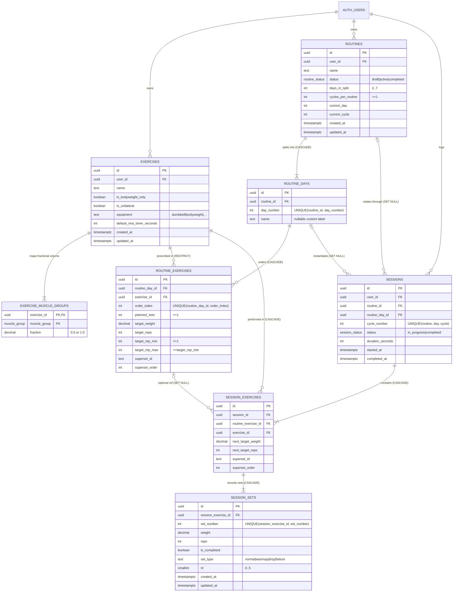

> **Reference Pack Metadata**
> - **App Name:** Best Damn Weight Lifting Tracker Ever (`weightliftinglog` / UI Banner: *Best Damn Workout Tracker Ever*)
> - **Git Commit SHA & Branch:** `193549d` (`main`) + Phase 3A Basement Express Working Tree Updates — Base Commit `2026-11-14 08:30:17 -0600`
> - **Snapshot Date:** `2026-11-14`
> - **File Scope:** Complete PostgreSQL & client-side storage inventory, table columns/types/constraints/indexes, RLS security model, Mermaid ER diagram, migration history, seed catalog, and import/export capabilities.

# 02 — Data Model & Schema

## 1. Storage Inventory Overview

| Storage Layer | Count | Summary |
| :--- | :--- | :--- |
| **PostgreSQL Tables (`public`)** | **8** | `exercises`, `exercise_muscle_groups`, `routines`, `routine_days`, `routine_exercises`, `sessions`, `session_exercises`, `session_sets` (plus FK dependency on `auth.users`) |
| **PostgreSQL Custom Enums** | **3** | `routine_status`, `muscle_group`, `session_status` |
| **SQL Migrations** | **9** | Sequential additive DDL, RLS hardening, data-safety, Phase 2 programming, & Phase 3A sub-muscle/unilateral/equipment scripts in `supabase/migrations/` |
| **Client-Side Zustand Stores** | **2** | `useActiveWorkoutStore` (`src/store/useActiveWorkoutStore.ts`) & `usePreferencesStore` (`src/store/usePreferencesStore.ts`) |
| **AsyncStorage Namespaces** | **3** | `@supabase/supabase-js` Auth JWT session, `'weightlifting-active-workout-v1'`, and `'weightlifting-preferences-v1'` |

---

## 2. Custom PostgreSQL Enum Types

Defined in `20260713165135_initial_schema.sql`, extended in `20260820000000_add_core_muscle_group.sql`, and expanded with sub-muscle literals in `20261115000000_phase3a_basement_gym_submuscles_and_unilateral.sql`:

| Enum Name | Allowed Values | Notes |
| :--- | :--- | :--- |
| `routine_status` | `'draft'`, `'active'`, `'completed'` | `'completed'` is never written by current app code (cycles increment indefinitely). |
| `muscle_group` | `'Chest'`, `'Lats'`, `'Upper Back'`, `'Shoulders'`, `'Quads'`, `'Hamstrings'`, `'Glutes'`, `'Calves'`, `'Biceps'`, `'Triceps'`, `'Core'` *(plus legacy `'Back'`, `'Legs'` retained in Postgres enum for backward compat)* | Migration 9 appends `'Lats'`, `'Upper Back'`, `'Quads'`, `'Hamstrings'`, `'Glutes'`, `'Calves'` outside `BEGIN; ... COMMIT;`, remaps seeds `'...0001..0012'`, and migrates legacy `'Back' -> 'Upper Back'` & `'Legs' -> 'Quads'`. |
| `session_status` | `'in_progress'`, `'completed'` | Column defaults to `'in_progress'`, but `app/workout/complete.tsx` inserts directly with `'completed'`. |

---

## 3. Complete Table & Column Inventory (`public` Schema)

All UUID primary keys use `uuid_generate_v4()` from the `uuid-ossp` extension.

### 3.1 `exercises`
Master library containing both immutable system-seeded exercises (`user_id = '00000000-0000-0000-0000-000000000000'`) and user-created custom exercises.

| Column | Type | Nullable | Default | Constraints & Foreign Keys |
| :--- | :--- | :--- | :--- | :--- |
| `id` | `UUID` | `NOT NULL` | `uuid_generate_v4()` | `PRIMARY KEY` |
| `user_id` | `UUID` | `NOT NULL` | — | `REFERENCES auth.users(id) ON DELETE CASCADE` |
| `name` | `TEXT` | `NOT NULL` | — | Exercise display name |
| `is_bodyweight_only` | `BOOLEAN` | `NOT NULL` | `FALSE` | Flags bodyweight exercises |
| `is_unilateral` | `BOOLEAN` | `NOT NULL` | `FALSE` | Added in migration 9; flags per-side single-arm/single-leg movements (`2x` tonnage, `1x` e1RM) |
| `equipment` | `TEXT` | `NOT NULL` | `'dumbbell'` | Added in migration 9; `CHECK (equipment IN ('dumbbell', 'bodyweight', 'barbell', 'cable', 'machine', 'kettlebell', 'band', 'pullup_dip_bar'))` |
| `default_rest_timer_seconds` | `INTEGER` | `NOT NULL` | `90` | Rest countdown duration triggered on set completion (`60s` on Phase 3A Basement Express seeds) |
| `created_at` | `TIMESTAMPTZ` | `NULL` | `NOW()` | Creation timestamp |
| `updated_at` | `TIMESTAMPTZ` | `NULL` | `NOW()` | Updated manually in app writes (no DB trigger) |

### 3.2 `exercise_muscle_groups`
Fractional muscle-synergy join table mapping each exercise to one primary (`1.0`) and zero or more secondary (`0.5`) muscle groups.

| Column | Type | Nullable | Default | Constraints & Foreign Keys |
| :--- | :--- | :--- | :--- | :--- |
| `exercise_id` | `UUID` | `NOT NULL` | — | `PK (part 1)`, `REFERENCES exercises(id) ON DELETE CASCADE` |
| `muscle_group` | `muscle_group` | `NOT NULL` | — | `PK (part 2)`, enum value |
| `fraction` | `DECIMAL(2,1)` | `NOT NULL` | — | `CHECK (fraction IN (0.5, 1.0))` |

### 3.3 `routines`
Top-level training split configuration and active sequential queue pointer (`current_day`, `current_cycle`).

| Column | Type | Nullable | Default | Constraints & Foreign Keys |
| :--- | :--- | :--- | :--- | :--- |
| `id` | `UUID` | `NOT NULL` | `uuid_generate_v4()` | `PRIMARY KEY` |
| `user_id` | `UUID` | `NOT NULL` | — | `REFERENCES auth.users(id) ON DELETE CASCADE` |
| `name` | `TEXT` | `NOT NULL` | — | Routine display title |
| `status` | `routine_status` | `NOT NULL` | `'draft'` | App enforces single `'active'` routine in client code (no partial unique DB index) |
| `days_in_split` | `INTEGER` | `NOT NULL` | — | `CHECK (days_in_split BETWEEN 2 AND 7)` (relaxed from `3..7` in migration 8) |
| `cycles_per_routine` | `INTEGER` | `NOT NULL` | — | `CHECK (cycles_per_routine >= 1)` |
| `current_day` | `INTEGER` | `NOT NULL` | `1` | Horizontal queue pointer (`1 .. days_in_split`; clamped when shortening split on edit) |
| `current_cycle` | `INTEGER` | `NOT NULL` | `1` | Current rotation cycle (`1 .. N`) |
| `created_at` | `TIMESTAMPTZ` | `NULL` | `NOW()` | Creation timestamp |
| `updated_at` | `TIMESTAMPTZ` | `NULL` | `NOW()` | Updated on routine creation, edit & workout completion |

### 3.4 `routine_days`
Discrete split days belonging to a routine (`1 .. days_in_split`).

| Column | Type | Nullable | Default | Constraints & Foreign Keys |
| :--- | :--- | :--- | :--- | :--- |
| `id` | `UUID` | `NOT NULL` | `uuid_generate_v4()` | `PRIMARY KEY` |
| `routine_id` | `UUID` | `NULL` | — | `REFERENCES routines(id) ON DELETE CASCADE`, `UNIQUE (routine_id, day_number)` |
| `day_number` | `INTEGER` | `NOT NULL` | — | `1`-based split index; `UNIQUE (routine_id, day_number)` |
| `name` | `TEXT` | `NULL` | — | Custom split day label added in migration 7 (`20261113000000_data_safety_and_day_names.sql`) |

> **Schema & Edit-Mode Compatibility Note:** `app/routine-builder/new.tsx` persists `day.name` into `routine_days.name` with a safe fallback retry if a remote PostgREST schema cache lags behind migration 7. When editing an existing routine, `new.tsx` upserts `routine_days` on `(routine_id, day_number)` instead of deleting/recreating rows, preserving existing `routine_day_id` UUIDs referenced by historical `sessions`, and deletes only `day_number > newDaysInSplit`.

### 3.5 `routine_exercises`
Ordered exercise prescriptions within a specific `routine_days` record, including rep ranges and superset grouping metadata.

| Column | Type | Nullable | Default | Constraints & Foreign Keys |
| :--- | :--- | :--- | :--- | :--- |
| `id` | `UUID` | `NOT NULL` | `uuid_generate_v4()` | `PRIMARY KEY` |
| `routine_day_id` | `UUID` | `NULL` | — | `REFERENCES routine_days(id) ON DELETE CASCADE`, `UNIQUE (routine_day_id, order_index)` |
| `exercise_id` | `UUID` | `NULL` | — | `REFERENCES exercises(id) ON DELETE RESTRICT` (blocks deleting exercises used in routines) |
| `order_index` | `INTEGER` | `NOT NULL` | — | `1`-based position within day; `UNIQUE (routine_day_id, order_index)` |
| `planned_sets` | `INTEGER` | `NOT NULL` | — | `CHECK (planned_sets >= 1)` |
| `target_weight` | `DECIMAL(6,2)` | `NULL` | — | Baseline target load (`lbs` in UI); updated on workout completion |
| `target_reps` | `INTEGER` | `NULL` | — | Target reps per set (synced with upper rep range / bodyweight overload) |
| `target_rep_min` | `INTEGER` | `NULL` | — | Added & backfilled in migration 8; `CHECK >= 1` & `<= target_rep_max` (`routine_exercises_rep_range_check`) |
| `target_rep_max` | `INTEGER` | `NULL` | — | Added & backfilled in migration 8; `CHECK >= 1` & `>= target_rep_min` |
| `superset_id` | `TEXT` | `NULL` | `NULL` | Added in migration 5 (`ss_<timestamp>_<rand>`); links paired exercises |
| `superset_order` | `INTEGER` | `NULL` | `1` | Added in migration 5; `1`-based order inside superset (`A1`, `A2`, ...) |

### 3.6 `sessions`
Historical workout session header tying a user's completed workout to a user account, and optionally to a routine, split day, and cycle number.

| Column | Type | Nullable | Default | Constraints & Foreign Keys |
| :--- | :--- | :--- | :--- | :--- |
| `id` | `UUID` | `NOT NULL` | `uuid_generate_v4()` | `PRIMARY KEY` |
| `user_id` | `UUID` | `NOT NULL` | — | `REFERENCES auth.users(id) ON DELETE CASCADE` |
| `routine_id` | `UUID` | `NULL` | — | `REFERENCES routines(id) ON DELETE SET NULL` (`sessions_routine_id_fkey`, updated in migration 7 — deleting a routine preserves sessions!) |
| `routine_day_id` | `UUID` | `NULL` | — | `REFERENCES routine_days(id) ON DELETE SET NULL` (`sessions_routine_day_id_fkey`, updated in migration 7) |
| `cycle_number` | `INTEGER` | `NOT NULL` | — | `UNIQUE (routine_id, routine_day_id, cycle_number)` |
| `status` | `session_status` | `NOT NULL` | `'in_progress'` | Always inserted as `'completed'` by `app/workout/complete.tsx` |
| `started_at` | `TIMESTAMPTZ` | `NULL` | `NOW()` | Computed on save as `Date.now() - durationSeconds * 1000` |
| `completed_at` | `TIMESTAMPTZ` | `NULL` | — | Set to `new Date().toISOString()` on save |
| `duration_seconds` | `INTEGER` | `NULL` | — | Added in migration 4 (`Math.max(elapsed, 60)`) |

### 3.7 `session_exercises`
Per-exercise record within a logged workout session, storing superset metadata and "Fresh Memory" target loads/reps for the next cycle.

| Column | Type | Nullable | Default | Constraints & Foreign Keys |
| :--- | :--- | :--- | :--- | :--- |
| `id` | `UUID` | `NOT NULL` | `uuid_generate_v4()` | `PRIMARY KEY` |
| `session_id` | `UUID` | `NULL` | — | `REFERENCES sessions(id) ON DELETE CASCADE` |
| `routine_exercise_id` | `UUID` | `NULL` | — | `REFERENCES routine_exercises(id) ON DELETE SET NULL` (`session_exercises_routine_exercise_id_fkey`, updated in migration 7; app inserts `NULL` and resolves routine target write-back with `(routine_day_id, exercise_id)` fallback) |
| `exercise_id` | `UUID` | `NULL` | — | `REFERENCES exercises(id) ON DELETE CASCADE` |
| `next_target_weight` | `DECIMAL(6,2)` | `NULL` | — | Captured during active workout for cycle `X+1` (weighted lifts) |
| `next_target_reps` | `INTEGER` | `NULL` | — | Persisted in `complete.tsx` for bodyweight exercises and read on workout start / Swap Exercise pre-fill |
| `superset_id` | `TEXT` | `NULL` | `NULL` | Added in migration 5 |
| `superset_order` | `INTEGER` | `NULL` | `1` | Added in migration 5 |

### 3.8 `session_sets`
Granular set-by-set performance log under a `session_exercises` record.

| Column | Type | Nullable | Default | Constraints & Foreign Keys |
| :--- | :--- | :--- | :--- | :--- |
| `id` | `UUID` | `NOT NULL` | `uuid_generate_v4()` | `PRIMARY KEY` |
| `session_exercise_id` | `UUID` | `NULL` | — | `REFERENCES session_exercises(id) ON DELETE CASCADE`, `UNIQUE (session_exercise_id, set_number)` |
| `set_number` | `INTEGER` | `NOT NULL` | — | `1`-based set index; `UNIQUE (session_exercise_id, set_number)` |
| `weight` | `DECIMAL(6,2)` | `NULL` | — | Persisted as `parseFloat(s.weight) \|\| 0` (`0` for bodyweight or blank) |
| `reps` | `INTEGER` | `NULL` | — | Persisted as `parseInt(s.reps, 10) \|\| 0` |
| `is_completed` | `BOOLEAN` | `NOT NULL` | `FALSE` | Must be `TRUE` (and `set_type !== 'warmup'`) to count toward working volume, PRs, e1RM, and pre-fill history |
| `set_type` | `TEXT` | `NOT NULL` | `'normal'` | Added in migration 8 (`CHECK (set_type IN ('normal', 'warmup', 'drop', 'failure'))`) |
| `rir` | `SMALLINT` | `NULL` | — | Added in migration 8 (`CHECK (rir BETWEEN 0 AND 5)`) |
| `created_at` | `TIMESTAMPTZ` | `NULL` | `NOW()` | Used by Routine Builder to look up most recent completed working weight |
| `updated_at` | `TIMESTAMPTZ` | `NULL` | `NOW()` | Timestamp |

---

## 4. Indexes & Row-Level Security (RLS) Summary

### Explicit & Unique Indexes
Beyond primary keys, PostgreSQL maintains **9 secondary/unique indexes**:
1. `routine_days_routine_id_day_number_key` — `UNIQUE (routine_id, day_number)` on `routine_days`
2. `routine_exercises_routine_day_id_order_index_key` — `UNIQUE (routine_day_id, order_index)` on `routine_exercises`
3. `sessions_routine_id_routine_day_id_cycle_number_key` — `UNIQUE (routine_id, routine_day_id, cycle_number)` on `sessions`
4. `session_sets_session_exercise_id_set_number_key` — `UNIQUE (session_exercise_id, set_number)` on `session_sets`
5. `idx_sessions_user_started` — `INDEX (user_id, started_at DESC)` on `sessions` (migration 4)
6. `idx_routine_exercises_superset` — `INDEX (routine_day_id, superset_id)` on `routine_exercises` (migration 5)
7. `idx_session_exercises_superset` — `INDEX (session_id, superset_id)` on `session_exercises` (migration 5)
8. `idx_sessions_routine_day_id` — `INDEX (routine_day_id)` on `sessions` (migration 7)
9. `idx_session_exercises_routine_exercise_id` — `INDEX (routine_exercise_id)` on `session_exercises` (migration 7)

### Row-Level Security & Role Grants (Post-Phase 1 Hardening)
- **`anon` role:** `USAGE` on `public` schema and all table privileges **revoked**. Unauthenticated requests cannot read or mutate any table.
- **`authenticated` role:** Explicit `SELECT, INSERT, UPDATE, DELETE` granted on the 8 public tables (`ALTER DEFAULT PRIVILEGES` revoked so future tables are not auto-exposed).
- **Ownership Policies:**
  - `exercises` & `exercise_muscle_groups`: `SELECT` permitted when `user_id = auth.uid()` **or** `user_id = '00000000-0000-0000-0000-000000000000'` (system seed library). `INSERT`, `UPDATE`, and `DELETE` strictly require `user_id = auth.uid()` (system library rows are immutable).
  - `routines`: `FOR ALL` requires `auth.uid() = user_id` (`USING` and `WITH CHECK`).
  - `sessions`: Re-asserted in migration 7 (`TO authenticated`) strictly via `(select auth.uid()) = user_id`, ensuring orphaned sessions with `routine_id IS NULL` or `routine_day_id IS NULL` stay readable and isolated by owner.
  - `routine_days`, `routine_exercises`, `session_exercises`, `session_sets`: `FOR ALL` verified via `EXISTS (...)` subquery joining back to parent `routines.user_id` or `sessions.user_id = (select auth.uid())`.

---

## 5. Entity-Relationship Diagram

---

## 6. Migration History, Seed Library & Import/Export Capabilities

### Migration Timeline (`supabase/migrations/`)
1. `20260713165135_initial_schema.sql` — Enables `uuid-ossp`; creates 3 enums and all 8 base tables.
2. `20260724075500_add_rls_policies.sql` — Enables RLS on all 8 tables; adds initial ownership policies and broad `anon`/`authenticated` grants.
3. `20260728103000_phase1_security_hardening.sql` — Makes system exercises (`00000000-0000-0000-0000-000000000000`) read-only, tightens `exercise_muscle_groups` write policies to owned exercises, revokes `anon` schema/table access, and applies explicit least-privilege grants to `authenticated`.
4. `20260728110000_phase2_session_persistence.sql` — Adds `sessions.duration_seconds` (`INTEGER`) and `idx_sessions_user_started`.
5. `20260818000000_add_superset_support.sql` — Adds `superset_id` and `superset_order` to `routine_exercises` and `session_exercises` plus lookup indexes. *(Note: `routine-builder/new.tsx` and `workout/complete.tsx` include runtime fallback catch blocks that retry inserts without `superset_id`/`superset_order` if a remote PostgREST schema cache lags behind migration 5).*
6. `20260820000000_add_core_muscle_group.sql` — Appends `'Core'` to `public.muscle_group` enum.
7. `20261113000000_data_safety_and_day_names.sql` — Converts `sessions.routine_id`, `sessions.routine_day_id`, and `session_exercises.routine_exercise_id` foreign keys from `ON DELETE CASCADE` to `ON DELETE SET NULL`; adds `idx_sessions_routine_day_id` & `idx_session_exercises_routine_exercise_id`; re-asserts `sessions`, `session_exercises`, and `session_sets` RLS strictly via `sessions.user_id = (select auth.uid())`; adds `routine_days.name TEXT`.
8. `20261114000000_phase2_supersets_and_programming.sql` — Dynamically drops old `days_in_split` CHECK constraint and sets `CHECK (days_in_split BETWEEN 2 AND 7)`; adds `routine_exercises.target_rep_min` & `target_rep_max` (backfilled from `target_reps`) with `routine_exercises_rep_range_check`; adds `session_sets.set_type` (`normal | warmup | drop | failure`) and `session_sets.rir` (`SMALLINT BETWEEN 0 AND 5`); reloads PostgREST schema cache (`NOTIFY pgrst, 'reload schema'`). Client writes degrade gracefully when remote schemas lag behind migration 8.
9. `20261115000000_phase3a_basement_gym_submuscles_and_unilateral.sql` — Appends `'Lats'`, `'Upper Back'`, `'Quads'`, `'Hamstrings'`, `'Glutes'`, `'Calves'` to `public.muscle_group` outside `BEGIN; ... COMMIT;`; adds `exercises.is_unilateral` (`BOOLEAN NOT NULL DEFAULT FALSE`) and `exercises.equipment` (`CHECK` including `'dumbbell'`, `'bodyweight'`, `'barbell'`, `'cable'`, `'machine'`, `'kettlebell'`, `'band'`, `'pullup_dip_bar'`); ensures seed user (`00000000-0000-0000-0000-000000000000`) in `auth.users`; backfills equipment & remaps sub-muscles on seeds `...0001..0012`; performs collision-safe custom-exercise migration (`'Back' -> 'Upper Back'`, `'Legs' -> 'Quads'`); upserts `18` Basement Express dumbbell/incline-bench/bodyweight exercises (`...0013..0030`) at `60s` rest with `WHERE EXISTS` FK guards on `exercise_muscle_groups`.

### Client-Side Persisted Store Schema (`AsyncStorage` via Zustand)
- **`useActiveWorkoutStore` (`weightlifting-active-workout-v1`, `src/store/useActiveWorkoutStore.ts`):** Persists `draft: ActiveWorkoutDraft | null` (`userId`, `routineId`, `routineName`, `routineDayId`, `dayNumber`, `dayName`, `cycleNumber`, `daysInSplit`, `cyclesPerRoutine`, `startedAtTimestamp`, `durationSeconds`, `workoutExercises` including per-set `set_type` & `rir` and per-exercise `target_rep_min`, `target_rep_max`, `next_target_reps`, `is_unilateral`, `equipment`, `is_swapped`, `restTimerEndTimestamp`, `restTimerTotalSeconds`, `restTimerLabel`, `syncStatus: 'in_progress' | 'pending_sync'`, `savedSessionId`) alongside an in-memory `_hasHydrated` boolean.
- **`usePreferencesStore` (`weightlifting-preferences-v1`, `src/store/usePreferencesStore.ts`, `version: 2` + `migrate`):** Persists `defaultRestSeconds: 45 | 60 | 90 | 120 | 180` (default `60`), `lockRestTimerToDefault: boolean` (default `true`), `supersetTransitionSeconds: 0 | 15 | 30 | 45` (default `0`), `hapticsEnabled: boolean` (default `true`), `filterByMyGym: boolean` (default `true`), `allowedEquipment: EquipmentType[]` (default `['dumbbell', 'bodyweight']`), and `maxDumbbellWeightLbs: number | null` (default `50`) alongside `_hasHydrated`.

### Built-In Seed Data (`supabase/seed.sql`)
Upserts the system seed user (`00000000-0000-0000-0000-000000000000`, `system@weightlog.local`), **`30` global exercises** (`...0001` through `...0030`), and fractional sub-muscle mappings across all **`11` sub-muscles** (`Chest`, `Lats`, `Upper Back`, `Shoulders`, `Quads`, `Hamstrings`, `Glutes`, `Calves`, `Biceps`, `Triceps`, `Core`):
- **`...0001..0012` (Original Seed Catalog — Backfilled):** Accurate equipment values and sub-muscle remaps replacing `'Legs'`/`'Back'` (e.g., Barbell Back Squat -> `Quads 1.0` + `Glutes 0.5`; Romanian Deadlift -> `Hamstrings 1.0` + `Glutes 0.5` + `Upper Back 0.5`; Pull-Up -> `Lats 1.0` + `Biceps 0.5`).
- **`...0013..0030` (18 Basement Express Seeds):** Unilateral & bilateral adjustable-dumbbell, incline-bench, and zero-rig bodyweight exercises (covering `Quads`, `Hamstrings`, `Glutes`, `Calves`, `Lats`, `Upper Back`, `Chest`, `Shoulders`, `Biceps`, `Triceps`, and `Core`) configured with `60s` default rest timers.

### Data Import, Export & Backup Capabilities
- **CSV Export (Web-Only, Partial Schema):** `app/analytics/index.tsx` (`handleExportCSV`) exports flat set rows (`Date,Routine,Cycle,Exercise,Set,Weight(lbs),Reps,Completed,Estimated1RM(lbs),SetType,RIR,Unilateral,SetTonnage(lbs)`, setting `Estimated1RM(lbs)` to `0` on `warmup` rows and `SetTonnage(lbs)` to `getSetTonnage(w, r, isUnilateral)` for working completed sets else `0`) via DOM `Blob` download **only when `Platform.OS === 'web'`**. On iOS and Android, tapping **Export CSV** is a silent no-op (`expo-file-system` / `expo-sharing` are not installed). Routines, split structures, custom exercises, and muscle mappings are not exported.
- **Data Import / Restore:** **None.** No CSV, JSON, Strong/Hevy import, or backup/restore mechanism exists.
- **Cascade Deletion Mitigation:** Fixed in migration 7 (`20261113000000_data_safety_and_day_names.sql`): `sessions.routine_id`, `sessions.routine_day_id`, and `session_exercises.routine_exercise_id` use `ON DELETE SET NULL`, so deleting a routine or split day preserves all historical sessions, sets, and PRs under `sessions.user_id`.
