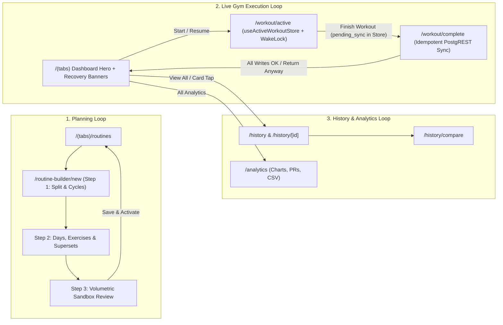

> **Reference Pack Metadata**
> - **App Name:** Best Damn Weight Lifting Tracker Ever (`weightliftinglog` / UI Banner: *Best Damn Workout Tracker Ever*)
> - **Git Commit SHA & Branch:** `9a6f80e` (`main`) + Phase 1 Working Tree Updates — Base Commit `2026-09-30 18:54:32 -0500`
> - **Snapshot Date:** `2026-11-13`
> - **File Scope:** Complete inventory of all 16 Expo Router files (3 layouts + 13 screens), inline modals, backend data touchpoints, end-to-end UX walkthroughs of the 3 core product loops, mobile ergonomics, and active-session state architecture.

# 04 — UI Flows & Routes

## 1. Route, Screen, Modal & Endpoint Inventory

### Summary Counts
- **Expo Router Files (`app/`):** **16 total** — **3 Layout files** + **13 Routable Screens** (`11` standard stack/tab screens + `2` route-level modals).
- **Inline `<Modal>` Overlays:** **3 total** — **2 active** (`routines.tsx` delete confirmation, `routine-builder/new.tsx` exercise picker/creator) + **1 orphaned** (`src/components/MuscleFeedbackModal.tsx`).
- **Custom Backend Endpoints / Server Actions / Edge Functions:** **0**. All screens communicate directly with Supabase Auth (`supabase.auth.*`) and PostgREST (`supabase.from('<table_name>')`).

### Complete Route & Screen Matrix

| Route Path | Source File | Navigator / Presentation | Supabase Tables Read / Written | Primary Purpose |
| :--- | :--- | :--- | :--- | :--- |
| *(Root Wrapper)* | `app/_layout.tsx` | Root `Stack` + Auth Gate | `auth` (`getSession`, `onAuthStateChange`) | Redirects unauthenticated users to `/(auth)/login` and signed-in users away from `(auth)` to `/(tabs)`. |
| *(Auth Wrapper)* | `app/(auth)/_layout.tsx` | Nested `Stack` | — | Headerless wrapper for login/signup flow. |
| `/(auth)/login` | `app/(auth)/login.tsx` | Screen | `auth` (`signInWithPassword`, `signUp`) | Email/password login & registration (`display_name` stored in `user_metadata`). |
| *(Tabs Wrapper)* | `app/(tabs)/_layout.tsx` | Bottom `Tabs` (`3` tabs) | — | Dark-slate bottom tab bar: **Dashboard**, **Exercises**, **Routines**. |
| `/` (`/(tabs)`) | `app/(tabs)/index.tsx` | Tab 1: Dashboard | **R:** `auth`, `routines` (+days/exercises/muscles), `sessions` (+exercises/sets) | Weekly KPIs, streak, Resume/Sync banners (`useActiveWorkoutStore`), Hero Workout launcher, RIR badge, top-3 e1RM sparklines, Weekly Volume Impact ring & muscle bars, last 3 sessions. |
| `/(tabs)/exercises` | `app/(tabs)/exercises.tsx` | Tab 2: Exercises | **R:** `exercises`, `exercise_muscle_groups` (via `useExercises`) | Searchable master exercise list with primary (`1.0x`) & secondary (`0.5x`) badges, bodyweight/weighted label, and rest timer. |
| `/(tabs)/routines` | `app/(tabs)/routines.tsx` | Tab 3: Routines | **R/W/D:** `routines`, `routine_days` | Lists user routines, switches active routine (`status='active'` -> `'draft'`), launches builder, or deletes routine via modal reassuring workout logs & PRs are preserved. |
| `/settings` | `app/settings.tsx` | Stack `modal` | **R/W:** `auth` (`getSession`, `updateUser`, `signOut`) | Edits `display_name`, persists rest-timer defaults & haptics toggle via `usePreferencesStore`, displays hardcoded DB health badge, signs out. |
| `/exercises/[id]` | `app/exercises/[id].tsx` | Stack `modal` | **R/W/D:** `exercises`, `exercise_muscle_groups` | Creates (`id="new"`), edits, or deletes custom exercises; renders seeded system exercises read-only with **Duplicate as Custom Exercise**. |
| `/routine-builder/new` | `app/routine-builder/new.tsx` | Stack Screen | **R:** `exercises`, `exercise_muscle_groups`, `session_sets` **W:** `exercises`, `exercise_muscle_groups`, `routines`, `routine_days`, `routine_exercises` | 3-step "Sandbox Mode" wizard for building 3–7 day splits, persisting `routine_days.name`, pairing supersets, previewing weekly muscle sets, and saving/activating (`active`-only deactivation). |
| `/workout/active` | `app/workout/active.tsx` | Stack Screen (`gestureEnabled: false`) | **R:** `routines` (+days/exercises), `session_exercises` (+sessions/sets) | Crash-safe Live Gym Floor Logger backed by `useActiveWorkoutStore`: `expo-keep-awake`, wall-clock rest countdown + `AppState` sync, superset round gating, Set-1 cloning, Next Target Weight. |
| `/workout/complete` | `app/workout/complete.tsx` | Stack Screen (`gestureEnabled: false`) | **R/W/D:** `sessions`, `routine_days`, `session_exercises`, `session_sets`, `routine_exercises`, `routines` | Reads hydrated `pending_sync` workout from `useActiveWorkoutStore` (route-param fallback), tracks `savedSessionId` across retries, propagates `target_weight`, advances `(current_day, current_cycle)`, clears store only on full success. |
| `/history` | `app/history/index.tsx` | Stack Screen | **R:** `sessions` (+routines/exercises/sets) | Horizontal monthly consistency strip + chronological list of all logged sessions with tonnage, sets, duration, and top e1RM. |
| `/history/[id]` | `app/history/[id].tsx` | Stack Screen | **R:** `sessions` (current + previous cycle match), `routine_days` | Detailed session report: 4 KPIs, cycle-over-cycle tonnage growth banner, session muscle stimulus bars, standalone & superset set logs, Compare link with accurate `day_number`. |
| `/history/compare` | `app/history/compare.tsx` | Stack Screen *(implicit)* | **R:** `routines`, `routine_days`, `sessions` (+exercises/sets) | Routine picker (when `>1` routine) + custom-named split-day selector rendering `CycleComparisonView` overload diffs. *(Auto-registered by Expo Router).* |
| `/analytics` | `app/analytics/index.tsx` | Stack Screen | **R:** `sessions` (+routines/exercises/muscles/sets) | Performance Hub: 4 lifetime KPIs, exercise-selectable Epley 1RM `LineChart`, 7-muscle `RadarChart` + MAV status list, weekly `BarChart`, 12-week local-date `ConsistencyHeatmap`, PR Wall, Web CSV export. |

---

## 2. Core User Experience Walkthroughs

### Loop 1: Program & Workout Planning
1. **Entry:** From Dashboard (**Create Routine** onboarding CTA) or `/(tabs)/routines` (**Create Routine** button), user navigates to `/routine-builder/new`. *(Note: tapping **Edit Split** on an existing routine still routes to `/routine-builder/new` without an ID, starting a blank routine rather than editing; deleting a routine in `/(tabs)/routines` preserves all logged workout history, sets, and PRs via `ON DELETE SET NULL`).*
2. **Step 1 — Split Setup:** User sets `Routine Name` (default `"My Custom Split"`), picks `Days in Split Rotation` (`3d`, `4d`, `5d`, `6d`, or `7d` — dynamically resizing the `days` array), and selects `Total Cycles Before Reset` (`2`, `3`, `4`, or `6`).
3. **Step 2 — Assign Exercises & Supersets:**
   - User switches across horizontal day tabs (`Day 1 .. Day N`) and can edit custom `Day Name` labels, which persist to `routine_days.name` (with a PostgREST schema-cache retry fallback).
   - Tapping **+ Exercise** or **+ Superset** opens the full-screen **Select Exercise `<Modal>`**, which supports live search by exercise or muscle name and an inline **+ Add New** exercise creation form (using `usePreferencesStore.defaultRestSeconds` and persisting to `exercises` + `exercise_muscle_groups`).
   - Selecting a weighted exercise queries `session_sets` for the user's most recent completed weight on that exercise to pre-fill `Target (lbs)` (defaulting `Sets = 3`, `Target Reps = 10`).
   - Adjacent standalone exercises can be linked via **Pair Next** into `SUPERSET A/B/...` (`A1`, `A2`, ...), displaying live muscle-synergy badges (*Antagonist Synergy*, *Non-Competing Pair*, or *Competing Muscles*), **+ Add Paired**, and **Unlink** controls.
   - User can jump straight to **Save & Activate** from Step 2 or proceed to Step 3.
4. **Step 3 — Volumetric Sandbox Review:** Displays real-time weekly set totals per muscle group (`SUM(planned_sets * fraction)`) with color-coded progress bars (`<6` amber sub-optimal, `6–20` emerald optimal, `>20` rose high fatigue). User commits via **Save & Activate Routine** (deactivating only previously `'active'` routines to `'draft'`, preserving any `'completed'` routines) or **Save as Draft**.

### Loop 2: Live Workout Execution
1. **Pre-Workout Launch & Recovery Banners:** Dashboard Hero Card displays `Day X of Y`, `Target: Z RIR (Cycle C)`, and up to 5 scheduled lift chips with target weights and set counts. If `useActiveWorkoutStore` holds a matching local draft, Dashboard also renders a prominent green **Resume In-Progress Workout** banner (`syncStatus === 'in_progress'`) or an amber **Unsaved Workout Ready to Sync** retry banner (`syncStatus === 'pending_sync'`).
2. **Hydration, Wake-Lock & Ghost History:** `ActiveWorkoutScreen` waits for Zustand AsyncStorage `_hasHydrated`; if a matching draft exists for `userId`, it resumes directly from local state without data loss. Otherwise, it queries the current `routine_days` exercises and past completed `session_exercises`:
   - Each set's editable weight input pre-fills with `next_target_weight` (or last/max completed weight, routine `target_weight`, or `'135'`), while the **PREVIOUS** column shows set-specific ghost text from the last session (e.g., `185 lbs × 8` or `BW × 12`).
   - `KeepAwake.activateKeepAwakeAsync` holds a screen wake-lock while the workout screen is active.
3. **Logging Sets & Set-1 Cloning:**
   - Editing **Set 1** weight or reps automatically clones the new value down to all subsequent *uncompleted* sets of that exercise and persists immediately to `useActiveWorkoutStore`.
   - Tapping a set's completion checkbox fires `Haptics.impactAsync(Medium)` (when `hapticsEnabled` is true), locks that row's `TextInput`s (`editable={!isCompleted}`), updates the top real-time bar (**Tonnage lbs**, **Completed/Total Sets**, **Density lbs/m**), and recalculates the exercise's live `1RM ~X` badge and `Next Target Weight`.
4. **Superset Round Execution & Background-Safe Rest Timer:**
   - Standalone exercises render via `SetRow` and start a wall-clock countdown (`restTimerEndTimestamp = Date.now() + restSeconds * 1000`, falling back to `usePreferencesStore.defaultRestSeconds`) immediately upon completing any set.
   - Supersets render in **Round 1 .. Round M** cards (`A1 -> Superset Next -> A2`). Completing `A1` in Round 1 cancels any running timer without starting a new one; completing the final exercise of Round 1 marks **Round Completed** and starts the floating countdown using `Math.max(...default_rest_timer_seconds)` across the superset's exercises (`+30s` / `Skip` adjust `restTimerEndTimestamp` in the store; `Haptics.notificationAsync(Success)` fires at `00:00` if `hapticsEnabled` and timer expired within `<5s`). An `AppState` listener reconciles remaining time (`Math.max(0, Math.ceil((restTimerEndTimestamp - Date.now()) / 1000))`) immediately when returning from phone lock or background apps.
5. **Mid-Workout Modifications & Exit / Pending-Sync Handling:**
   - **Allowed:** Adding extra sets (**Add Set** on standalone cards; **Add Round to Superset** on superset cards) and overriding **Next Target Weight** (all persisted live to `AsyncStorage`).
   - **Not Supported:** Mid-workout exercise swapping, adding unplanned exercises, deleting sets, or reordering exercises.
   - **Exit / Finish:** Hardware/swipe-back gestures are disabled (`gestureEnabled: false`). Tapping `X` prompts **Discard Workout?**, clearing `useActiveWorkoutStore` only upon confirmation. Tapping **Finish Workout** requires `>= 1` completed set, transitions `syncStatus` to `'pending_sync'`, and navigates cleanly to `/workout/complete` where `clearActiveWorkout()` runs only after all PostgREST writes succeed (tapping **Return Anyway** after a network failure preserves `'pending_sync'` in `AsyncStorage` for later retry).

### Loop 3: History & Analytics
1. **Workout History (`/history`):** Displays a horizontal day-by-day strip for the current month/year with green workout dots (note: `selectedMonth`/`selectedYear` state has no month-switcher UI buttons, locking the strip to the current calendar month) above a chronological `FlatList` of all sessions.
2. **Session Detail (`/history/[id]`):** Shows 4 KPI tiles (Tonnage, Sets, Duration, Density `lbs/min`), an automatic **Progressive Overload vs Cycle `C-1`** percentage banner (when `cycle_number > 1` on the same `routine_day_id`), session muscle-attribution bars, standalone/superset set breakdowns, and a Compare button passing the resolved `day_number`.
3. **Cycle Comparison (`/history/compare`):** Offers a **Routine Picker** when the user has multiple routines plus custom-named `Day 1 .. Day N` chips (joined from `routine_days`), accurately filtering sessions by `routine_day_id` / `day_number` to render `CycleComparisonView` overload diffs.
4. **Performance Hub (`/analytics`):** Accessible from Dashboard and History headers. Renders:
   - **4 Lifetime KPIs:** Lifetime Tonnage, Consistency Streak (current & best consecutive weeks), Avg Session Density (`lbs/min`), and Personal Records count.
   - **Strength Progression (`LineChart`):** Interactive SVG curve of session-best Epley 1RM for any chip-selected lift, with interactive last-5-session selector pills and amber PR point markers.
   - **Hypertrophy Volume Balance (`RadarChart` + Status List + `BarChart`):** 7-axis polygon comparing current-week fractional sets against a `14`-set target ring, per-muscle MEV/MAV/MRV badges, and a 12-week weekly tonnage bar chart.
   - **Consistency & Milestones:** 12-week Monday–Sunday `ConsistencyHeatmap` bucketed in local calendar time (`<5k`, `5k–15k`, `>=15k` lbs intensity shading) + **Personal Records Wall** + Web **Export CSV** button using `calculateEstimated1RM`.

---

## 3. Shared UI Patterns, Mobile Ergonomics & Session State

- **Visual Identity:** Consistent dark-mode aesthetic (`bg-slate-950` / `bg-slate-900`, `border-slate-800`, `blue-600` primary actions, `indigo-600` routine/superset accents, `purple-500` 1RM/overload badges, `emerald-500` completion states, `amber-500` PR trophies, aligned with `app.json` `"userInterfaceStyle": "dark"`) with persistent `"BEST DAMN WORKOUT TRACKER EVER"` eyebrow branding on every screen.
- **Gym-Floor Mobile Ergonomics:**
  - `selectTextOnFocus` on all weight/rep/target `TextInput`s allows one-tap overwrite without backspacing pre-filled values.
  - Completed set inputs lock (`editable={false}`) to prevent accidental fat-finger edits while scrolling, requiring explicit unchecking to edit.
  - `useSafeAreaInsets()` pads top headers dynamically; `hitSlop` (`12–16px`) enlarges destructive/close touch targets; web `window.confirm` / `window.alert` fallbacks replace native `Alert.alert` where multi-button native alerts fail on `react-native-web`.
- **Active Session State Architecture:** Managed via persisted Zustand state (`useActiveWorkoutStore` -> AsyncStorage `'weightlifting-active-workout-v1'`) with `_hasHydrated` startup guards, absolute `restTimerEndTimestamp` countdown storage, `syncStatus` (`'in_progress'` -> `'pending_sync'`), and persisted `savedSessionId` + `isSavingRef` idempotency guards in `app/workout/complete.tsx`.
