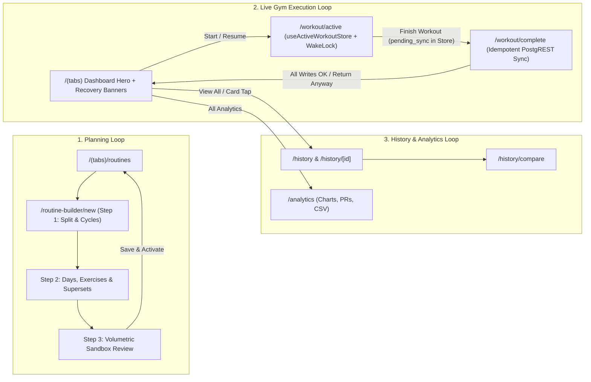

> **Reference Pack Metadata**
> - **App Name:** Best Damn Weight Lifting Tracker Ever (`weightliftinglog` / UI Banner: *Best Damn Workout Tracker Ever*)
> - **Git Commit SHA & Branch:** `193549d` (`main`) + Phase 3A Basement Express Working Tree Updates — Base Commit `2026-11-14 08:30:17 -0600`
> - **Snapshot Date:** `2026-11-14`
> - **File Scope:** Complete inventory of all 16 Expo Router files (3 layouts + 13 screens), inline modals, backend data touchpoints, end-to-end UX walkthroughs of the 3 core product loops, mobile ergonomics, and active-session state architecture.

# 04 — UI Flows & Routes

## 1. Route, Screen, Modal & Endpoint Inventory

### Summary Counts
- **Expo Router Files (`app/`):** **16 total** — **3 Layout files** + **13 Routable Screens** (`11` standard stack/tab screens + `2` route-level modals).
- **Inline `<Modal>` Overlays:** **4 total** — **3 active** (`routines.tsx` delete confirmation, `routine-builder/new.tsx` exercise picker/creator, `workout/active.tsx` crowded-gym Swap Exercise modal) + **1 orphaned** (`src/components/MuscleFeedbackModal.tsx`).
- **Custom Backend Endpoints / Server Actions / Edge Functions:** **0**. All screens communicate directly with Supabase Auth (`supabase.auth.*`) and PostgREST (`supabase.from('<table_name>')`).

### Complete Route & Screen Matrix

| Route Path | Source File | Navigator / Presentation | Supabase Tables Read / Written | Primary Purpose |
| :--- | :--- | :--- | :--- | :--- |
| *(Root Wrapper)* | `app/_layout.tsx` | Root `Stack` + Auth Gate | `auth` (`getSession`, `onAuthStateChange`) | Redirects unauthenticated users to `/(auth)/login` and signed-in users away from `(auth)` to `/(tabs)`. |
| *(Auth Wrapper)* | `app/(auth)/_layout.tsx` | Nested `Stack` | — | Headerless wrapper for login/signup flow. |
| `/(auth)/login` | `app/(auth)/login.tsx` | Screen | `auth` (`signInWithPassword`, `signUp`) | Email/password login & registration (`display_name` stored in `user_metadata`). |
| *(Tabs Wrapper)* | `app/(tabs)/_layout.tsx` | Bottom `Tabs` (`3` tabs) | — | Dark-slate bottom tab bar: **Dashboard**, **Exercises**, **Routines**. |
| `/` (`/(tabs)`) | `app/(tabs)/index.tsx` | Tab 1: Dashboard | **R:** `auth`, `routines` (+days/exercises/muscles), `sessions` (+exercises/sets) | Weekly warmup-excluded KPIs (`2x` unilateral tonnage, cap rep-PR trophies), streak, Resume/Sync banners, Hero Workout launcher (`lbs ea` unilateral chips), RIR badge, top-3 e1RM sparklines (`lbs ea` / `BW`), Weekly Volume ring & 11-muscle bars, last 3 sessions. |
| `/(tabs)/exercises` | `app/(tabs)/exercises.tsx` | Tab 2: Exercises | **R:** `exercises`, `exercise_muscle_groups` (via `useExercises`) | Searchable master exercise list with horizontal equipment filter chips (`My Gym (DB + BW)`, `Dumbbell`, `Bodyweight`, `All`), equipment & `PER SIDE` badges, normalized 11-muscle pills, and rest timer. |
| `/(tabs)/routines` | `app/(tabs)/routines.tsx` | Tab 3: Routines | **R/W/D:** `routines`, `routine_days` | Lists user routines, switches active routine (`status='active'` -> `'draft'`), opens **Edit Split** (`/routine-builder/new?routineId=<id>`), or deletes routine preserving logs & PRs. |
| `/settings` | `app/settings.tsx` | Stack `modal` | **R/W:** `auth` (`getSession`, `updateUser`, `signOut`) | Edits `display_name`, configures express rest default (`45/60/90/120/180s`), `Override Exercise Rest With Default`, superset breather, haptics, **My Gym & Equipment Cap** (`filterByMyGym`, `allowedEquipment`, `maxDumbbellWeightLbs`), signs out. |
| `/exercises/[id]` | `app/exercises/[id].tsx` | Stack `modal` | **R/W/D:** `exercises`, `exercise_muscle_groups` | Creates (`id="new"`), edits, or deletes custom exercises with 11-muscle selectors, `Equipment` pills synced with `isBodyweightOnly`, `Unilateral (Per-Side)` toggle, & PostgREST fallback retries; renders system exercises read-only with Duplicate CTA. |
| `/routine-builder/new` | `app/routine-builder/new.tsx` | Stack Screen | **R:** `routines` (+days/exercises when editing), `exercises`, `exercise_muscle_groups`, `session_sets` **W:** `exercises`, `exercise_muscle_groups`, `routines`, `routine_days`, `routine_exercises` | 3-step Sandbox wizard + **Edit Split** (`2–7d` splits, equipment-filtered picker & creator, `25/35 lb` DB defaults clamped to cap, live **Express Duration** pill, `PER SIDE`/`(ea)` & `getSupersetEquipmentTip` badges, 11-muscle `supersetSynergy.ts` & ACSM Step 3 review). |
| `/workout/active` | `app/workout/active.tsx` | Stack Screen (`gestureEnabled: false`) | **R:** `routines` (+days/exercises), `session_exercises` (+sessions/sets), `exercises` (on Swap) | Crash-safe Live Gym Floor Logger: Cycle/RIR header, `SetType`/`RIR` pills, `lbs ea`/`PER SIDE`/`EA` hints, `2x` tonnage & `1x` e1RM, express timer override & transition breather, equipment-filtered Swap modal, Smart `50 lb` DB Cap `+1` rep target progression. |
| `/workout/complete` | `app/workout/complete.tsx` | Stack Screen (`gestureEnabled: false`) | **R/W/D:** `sessions`, `routine_days`, `session_exercises`, `session_sets`, `routine_exercises`, `routines` | Saves hydrated `pending_sync` workout with `2x` unilateral tonnage, clamps non-manual DB targets to cap, saves `next_target_weight` & `next_target_reps`, enforces `safeMin`/`safeMax` check safety on current day while syncing only weight across siblings, advances cycle. |
| `/history` | `app/history/index.tsx` | Stack Screen | **R:** `sessions` (+routines/exercises/sets) | Horizontal monthly consistency strip + chronological session list with `2x` unilateral warmup-excluded tonnage, working sets, duration, and `1x` top e1RM. |
| `/history/[id]` | `app/history/[id].tsx` | Stack Screen | **R:** `sessions` (current + previous cycle match), `routine_days` | Session report: `2x` unilateral tonnage KPIs, cycle-over-cycle tonnage growth, normalized 11-muscle bars, `PER SIDE`/`lbs ea`/`WARMUP`/`DROP`/`FAIL`/`RIR`/`BW` set logs & weight×rep Recorded Next Targets, Compare link. |
| `/history/compare` | `app/history/compare.tsx` | Stack Screen *(implicit)* | **R:** `routines`, `routine_days`, `sessions` (+exercises/sets) | Routine picker + custom-named split-day selector rendering `CycleComparisonView` cards with `PER SIDE` badges and `ea` set weights. |
| `/analytics` | `app/analytics/index.tsx` | Stack Screen | **R:** `sessions` (+routines/exercises/muscles/sets), `routines` (active weekly target) | Performance Hub: `2x` unilateral KPIs, `1x` Epley 1RM `LineChart` (`ea` tooltips), **11-Muscle Group Volumetric Matrix** `RadarChart`, ACSM bars, `BarChart`, `ConsistencyHeatmap`, PR Wall (`PER SIDE`/`ea`), Web CSV (`+Unilateral,SetTonnage(lbs)`). |

---

## 2. Core User Experience Walkthroughs

### Loop 1: Program & Workout Planning
1. **Entry & Edit Split Hydration:** From Dashboard (**Create Routine** onboarding CTA) or `/(tabs)/routines` (**Create Routine** or **Edit Split** passing `routineId` -> `/routine-builder/new?routineId=<id>`), user enters `RoutineBuilderScreen`. When `routineId` is supplied, the screen hydrates existing routine settings, named `routine_days` (`id` + `name`), exercises, `planned_sets`, `target_weight`, `target_rep_min`/`target_rep_max`, and superset groupings. Deleting a routine in `/(tabs)/routines` preserves all logged workout history, sets, and PRs via `ON DELETE SET NULL`.
2. **Step 1 — Split Setup:** User sets `Routine Name` (default `"My Custom Split"`), picks `Days in Split Rotation` (`2d`, `3d`, `4d`, `5d`, `6d`, or `7d` — dynamically resizing the `days` array), and selects `Total Cycles Before Reset` (`2`, `3`, `4`, or `6`).
3. **Step 2 — Assign Exercises, Rep Ranges, Reordering & Supersets:**
   - User switches across horizontal day tabs (`Day 1 .. Day N`) and edits custom `Day Name` labels, persisted via FK-safe `(routine_id, day_number)` upserts on edit (clamping `routines.current_day` if shortened and deleting only trailing days).
   - Tapping **+ Exercise** or **+ Superset** opens the **Select Exercise `<Modal>`**, which provides horizontal equipment filter chips (`My Gym (DB + BW)`, `Dumbbell`, `Bodyweight`, `All`), live search, `PER SIDE` / equipment pills, and an inline **+ Add New** form with equipment & unilateral toggles (using `usePreferencesStore.defaultRestSeconds`).
   - Selecting a weighted exercise queries `session_sets` filtered via `isWorkingCompletedSet` to pre-fill `Target (lbs)`, falling back to `getDefaultStartingWeight` (`25 lb` unilateral DB / `35 lb` bilateral DB clamped to `maxDumbbellWeightLbs`). Every lift supports **`Sets`**, **`Rep Min`**, **`Rep Max`**, and **`Target (lbs)`** (`(ea)` for unilateral, hidden for bodyweight), plus **Up / Down** reorder controls for standalone/superset blocks and inner superset slots (`A1 ↔ A2`).
   - Adjacent standalone exercises link via **Pair Next** into `SUPERSET A/B/...` (`A1`, `A2`, ...), displaying true antagonist (`Chest ↔ Lats/Upper Back`, `Biceps ↔ Triceps`, `Quads ↔ Hamstrings`) & synergy badges, dial-change tips (`getSupersetEquipmentTip`), non-blocking guardrails (`evaluateSplitDayGuardrails`), and live **Express Duration** estimates (`estimateSplitDayMinutes`).
   - User can jump straight to **Save & Activate** / **Save & Activate Changes** from Step 2 or proceed to Step 3.
4. **Step 3 — Volumetric Sandbox Review:** Displays real-time weekly set totals across all **11 sub-muscles** (`SUM(planned_sets * fraction)`) with color-coded progress bars aligned to ACSM landmarks (`0s` slate, `<6s` amber, `6–9.5s` sky, `10–22s` emerald, `>22s` rose) plus Express Duration summary. User commits via **Save & Activate Routine** (deactivating only previously `'active'` routines to `'draft'`, preserving `'completed'` routines) or **Save as Draft** (with PostgREST schema-cache retry fallbacks).

### Loop 2: Live Workout Execution
1. **Pre-Workout Launch & Recovery Banners:** Dashboard Hero Card displays `Day X of Y`, `Target: Z RIR (Cycle C)`, and up to 5 scheduled lift chips with target weights (`lbs ea` on unilateral) and set counts. If `useActiveWorkoutStore` holds a matching local draft, Dashboard renders **Resume In-Progress Workout** (`syncStatus === 'in_progress'`) or **Unsaved Workout Ready to Sync** (`syncStatus === 'pending_sync'`).
2. **Hydration, Wake-Lock & Warmup-Filtered Ghost History:** `ActiveWorkoutScreen` waits for `_hasHydrated`; if a matching draft exists for `userId`, it restores (and backfills missing `is_unilateral`/`equipment` metadata on legacy drafts) from `AsyncStorage`. Otherwise, it queries `routine_days` and completed `session_exercises` filtered through `isWorkingCompletedSet(st)` so past warmups never leak into working weight pre-fills or `PREVIOUS` ghost text (clamping non-manual dumbbell baselines to `maxDumbbellWeightLbs` and defaulting new DB lifts to `25/35 lb`). Header displays `Cycle C/Total • Target Z RIR`, and each lift displays `PER SIDE` / rep ranges (`8–12 reps`). `KeepAwake` maintains screen wake-lock.
3. **Set Types, RIR, Unilateral/Bodyweight Parity & Working-Set Auto-Cloning:**
   - Tapping a set badge cycles **`#` (normal) -> `W` (warmup) -> `D` (drop) -> `F` (failure)** on both `SetRow` (`lbs ea` placeholder when unilateral) and superset round rows (`W•A1`, `EA`); tapping the **RIR** pill cycles **`— -> 0 -> 1 -> 2 -> 3 -> 4+`**.
   - Editing the **first working set** (`set_type !== 'warmup'`) clones weight/reps down to subsequent uncompleted **working** sets only — editing a `'warmup'` set never overwrites working sets.
   - Bodyweight-only lifts display **`BW`** badges (load `'0'`) and bind **Next Target Reps** (`next_target_reps`). Capped dumbbell lifts (`>= maxDumbbellWeightLbs`) clamp non-manual target weight and unlock **`"Next Target Reps (At 50 lb Cap)"`** (`+1` rep progression up to `30`).
   - Completing a working set fires `Haptics.impactAsync(Medium)` (when enabled), locks the row, updates the live top bar (`2x` unilateral Tonnage, Working Completed Sets, Density), and recalculates `1x` per-limb `1RM ~X` and overload targets.
4. **Superset Round Execution, Express Timer Override, Transition Breather & Recovery Timer:**
   - Standalone exercises start `"Rest Timer"` (`defaultRestSeconds` when `lockRestTimerToDefault` is on, else exercise default).
   - Supersets render **Round 1 .. Round M** cards (`A1 -> Superset Next -> A2`). Completing a non-final slot mid-round either cancels the running timer when `supersetTransitionSeconds === 0` or starts a cyan **`"Transition • Next Lift"`** countdown (`15s | 30s | 45s` from Settings). Completing the final slot marks **Round Completed** and starts full recovery rest. `+30s` and `Skip` preserve `restTimerLabel`, and `AppState` reconciles clock drift.
5. **Mid-Workout Modifications, Equipment-Filtered Swap Modal & Finish Recovery:**
   - **Swap Exercise (Crowded Gym):** Tapping **Swap** on any standalone card or superset slot opens the equipment-filtered **Swap Exercise `<Modal>`**, replacing the exercise in place (`is_swapped: true`, clearing `routine_exercise_id` so permanent routine templates are untouched) and loading warmup-filtered history for the substitute lift.
   - **Add / Remove Trailing Sets or Rounds:** Users can add extra sets/rounds and delete the trailing set/round (`Remove Set` / `Remove Round`) whenever `> 1` exists and the trailing row/round is uncompleted.
   - **Exit / Finish:** Swipe-back is disabled (`gestureEnabled: false`). `X` prompts **Discard Workout?**; **Finish Workout** transitions `syncStatus` to `'pending_sync'` and routes to `/workout/complete` where `clearActiveWorkout()` runs only after all writes succeed (writing both weight & reps at DB cap, enforcing `safeMin <= safeMax`, syncing only `target_weight` across sibling days, and falling back to `(routine_day_id, exercise_id)` if an Edit Split ran mid-draft).

### Loop 3: History & Analytics
1. **Workout History (`/history`):** Horizontal day strip for the current month (locked to current month/year) above a chronological `FlatList` of sessions with warmup-excluded `2x` unilateral tonnage, working sets, duration, and `1x` top e1RM.
2. **Session Detail (`/history/[id]`):** Warmup-excluded KPIs (`2x` unilateral Tonnage, Sets, Duration, Density), **Progressive Overload vs Cycle `C-1`** delta banner, normalized 11-muscle attribution bars, standalone/superset set logs displaying **`PER SIDE`**, **`lbs ea`**, **`BW`**, **`WARMUP`**, **`DROP`**, **`FAIL`**, and **`X RIR`** pills plus weight & reps Recorded Next Targets, and Compare link.
3. **Cycle Comparison (`/history/compare`):** Routine Picker + custom-named split-day chips filtering sessions cleanly to render `CycleComparisonView` diffs with `PER SIDE` & `ea` set annotations.
4. **Performance Hub (`/analytics`):**
   - **4 Lifetime KPIs** + **`1x` Epley 1RM `LineChart`** (all warmup-excluded, `ea` tooltips on unilateral lifts).
   - **Hypertrophy Volume Balance:** **11-Muscle Group Volumetric Matrix** `RadarChart` comparing current-week working sets against the active routine's planned split targets (falling back to `12`s ACSM baseline if no active routine), 11-muscle ACSM landmark badges (`0s / <6s / 6–9.5s / 10–22s / >22s`), and 12-week `BarChart` (`2x` unilateral tonnage).
   - **Consistency & Export:** 12-week local-calendar `ConsistencyHeatmap` (`2x` unilateral tonnage), **Personal Records Wall** (`PER SIDE` badges & `ea` loads), and Web **Export CSV** appending `SetType,RIR,Unilateral,SetTonnage(lbs)` columns (`Estimated1RM = 0` for warmups; `SetTonnage = 0` for warmup/uncompleted rows).

---

## 3. Shared UI Patterns, Mobile Ergonomics & Session State

- **Visual Identity:** Consistent dark-mode aesthetic (`bg-slate-950` / `bg-slate-900`, `border-slate-800`, `blue-600` primary actions, `indigo-600` routine/superset accents, `purple-500` 1RM/overload badges, `emerald-500` completion states, `amber-500` PR trophies, aligned with `app.json` `"userInterfaceStyle": "dark"`) with persistent `"BEST DAMN WORKOUT TRACKER EVER"` eyebrow branding on every screen.
- **Gym-Floor Mobile Ergonomics:**
  - `selectTextOnFocus` on all weight/rep/target `TextInput`s allows one-tap overwrite without backspacing pre-filled values.
  - Completed set inputs lock (`editable={false}`) to prevent accidental fat-finger edits while scrolling, requiring explicit unchecking to edit.
  - `useSafeAreaInsets()` pads top headers dynamically; `hitSlop` (`12–16px`) enlarges destructive/close touch targets; web `window.confirm` / `window.alert` fallbacks replace native `Alert.alert` where multi-button native alerts fail on `react-native-web`.
- **Active Session State Architecture:** Managed via persisted Zustand state (`useActiveWorkoutStore` -> AsyncStorage `'weightlifting-active-workout-v1'`) with `_hasHydrated` startup guards, absolute `restTimerEndTimestamp` countdown storage, `syncStatus` (`'in_progress'` -> `'pending_sync'`), and persisted `savedSessionId` + `isSavingRef` idempotency guards in `app/workout/complete.tsx`.
