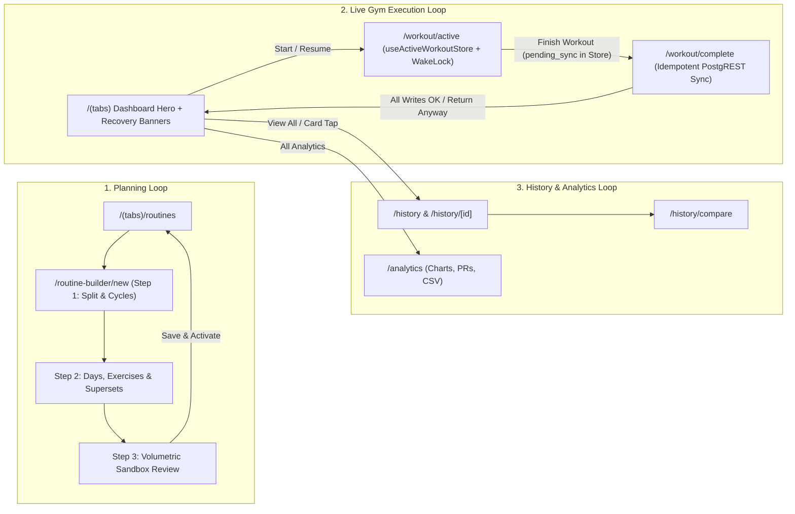

> **Reference Pack Metadata**
> - **App Name:** Best Damn Weight Lifting Tracker Ever (`weightliftinglog` / UI Banner: *Best Damn Workout Tracker Ever*)
> - **Git Commit SHA & Branch:** `9a6f80e` (`main`) + Phase 1 & Phase 2 Working Tree Updates — Base Commit `2026-09-30 18:54:32 -0500`
> - **Snapshot Date:** `2026-11-14`
> - **File Scope:** Complete inventory of all 16 Expo Router files (3 layouts + 13 screens), inline modals, backend data touchpoints, end-to-end UX walkthroughs of the 3 core product loops, mobile ergonomics, and active-session state architecture.

# 04 — UI Flows & Routes

## 1. Route, Screen, Modal & Endpoint Inventory

### Summary Counts
- **Expo Router Files (`app/`):** **16 total** — **3 Layout files** + **13 Routable Screens** (`11` standard stack/tab screens + `2` route-level modals).
- **Inline `<Modal>` Overlays:** **4 total** — **3 active** (`routines.tsx` delete confirmation, `routine-builder/new.tsx` exercise picker/creator, `workout/active.tsx` crowded-gym Swap Exercise modal) + **1 orphaned** (`src/components/MuscleFeedbackModal.tsx`).
- **Custom Backend Endpoints / Server Actions / Edge Functions:** **0**. All screens communicate directly with Supabase Auth (`supabase.auth.*`) and PostgREST (`supabase.from('<table_name>')`).

### Complete Route & Screen Matrix

| Route Path | Source File | Navigator / Presentation | Supabase Tables Read / Written | Primary Purpose |
| :--- | :--- | :--- | :--- | :--- |
| *(Root Wrapper)* | `app/_layout.tsx` | Root `Stack` + Auth Gate | `auth` (`getSession`, `onAuthStateChange`) | Redirects unauthenticated users to `/(auth)/login` and signed-in users away from `(auth)` to `/(tabs)`. |
| *(Auth Wrapper)* | `app/(auth)/_layout.tsx` | Nested `Stack` | — | Headerless wrapper for login/signup flow. |
| `/(auth)/login` | `app/(auth)/login.tsx` | Screen | `auth` (`signInWithPassword`, `signUp`) | Email/password login & registration (`display_name` stored in `user_metadata`). |
| *(Tabs Wrapper)* | `app/(tabs)/_layout.tsx` | Bottom `Tabs` (`3` tabs) | — | Dark-slate bottom tab bar: **Dashboard**, **Exercises**, **Routines**. |
| `/` (`/(tabs)`) | `app/(tabs)/index.tsx` | Tab 1: Dashboard | **R:** `auth`, `routines` (+days/exercises/muscles), `sessions` (+exercises/sets) | Weekly warmup-excluded KPIs, streak, Resume/Sync banners (`useActiveWorkoutStore`), Hero Workout launcher, RIR badge, top-3 e1RM sparklines, Weekly Volume ring & muscle bars, last 3 sessions. |
| `/(tabs)/exercises` | `app/(tabs)/exercises.tsx` | Tab 2: Exercises | **R:** `exercises`, `exercise_muscle_groups` (via `useExercises`) | Searchable master exercise list with primary (`1.0x`) & secondary (`0.5x`) badges, bodyweight/weighted label, and rest timer. |
| `/(tabs)/routines` | `app/(tabs)/routines.tsx` | Tab 3: Routines | **R/W/D:** `routines`, `routine_days` | Lists user routines, switches active routine (`status='active'` -> `'draft'`), opens **Edit Split** (`/routine-builder/new?routineId=<id>`), or deletes routine preserving logs & PRs. |
| `/settings` | `app/settings.tsx` | Stack `modal` | **R/W:** `auth` (`getSession`, `updateUser`, `signOut`) | Edits `display_name`, persists default rest timer, superset transition breather (`Off/15s/30s/45s`) & haptics via `usePreferencesStore`, displays hardcoded DB badge, signs out. |
| `/exercises/[id]` | `app/exercises/[id].tsx` | Stack `modal` | **R/W/D:** `exercises`, `exercise_muscle_groups` | Creates (`id="new"`), edits, or deletes custom exercises; renders seeded system exercises read-only with **Duplicate as Custom Exercise**. |
| `/routine-builder/new` | `app/routine-builder/new.tsx` | Stack Screen | **R:** `routines` (+days/exercises when editing), `exercises`, `exercise_muscle_groups`, `session_sets` **W:** `exercises`, `exercise_muscle_groups`, `routines`, `routine_days`, `routine_exercises` | 3-step Sandbox wizard + **Edit Split** hydration (`routineId` param): `2–7d` splits, FK-safe `routine_days` upsert, block & slot Up/Down reordering, `Rep Min`/`Rep Max`, `supersetSynergy.ts` badges/guardrails, ACSM Step 3 review. |
| `/workout/active` | `app/workout/active.tsx` | Stack Screen (`gestureEnabled: false`) | **R:** `routines` (+days/exercises), `session_exercises` (+sessions/sets), `exercises` (on Swap) | Crash-safe Live Gym Floor Logger: Cycle/RIR header, `SetType`/`RIR` tap pills, working-set cloning, warmup-filtered history, transition breather / recovery timers, **Swap Exercise** modal, trailing **Remove Set/Round**, bodyweight `BW` & `Next Target Reps`. |
| `/workout/complete` | `app/workout/complete.tsx` | Stack Screen (`gestureEnabled: false`) | **R/W/D:** `sessions`, `routine_days`, `session_exercises`, `session_sets`, `routine_exercises`, `routines` | Reads hydrated `pending_sync` workout, excludes warmups from celebration summary, saves `set_type`/`rir`/`next_target_reps`, propagates weighted/BW targets (`!is_swapped`, `(routine_day_id, exercise_id)` fallback), advances `(current_day, current_cycle)`. |
| `/history` | `app/history/index.tsx` | Stack Screen | **R:** `sessions` (+routines/exercises/sets) | Horizontal monthly consistency strip + chronological list of sessions with warmup-excluded tonnage, sets, duration, and top e1RM. |
| `/history/[id]` | `app/history/[id].tsx` | Stack Screen | **R:** `sessions` (current + previous cycle match), `routine_days` | Detailed session report: warmup-excluded KPIs, cycle-over-cycle tonnage growth banner, muscle stimulus bars, standalone/superset set logs with `WARMUP`/`DROP`/`FAIL`/`RIR`/`BW` badges & `next_target_reps`, Compare link. |
| `/history/compare` | `app/history/compare.tsx` | Stack Screen *(implicit)* | **R:** `routines`, `routine_days`, `sessions` (+exercises/sets) | Routine picker (when `>1` routine) + custom-named split-day selector rendering `CycleComparisonView` warmup-excluded overload diffs. |
| `/analytics` | `app/analytics/index.tsx` | Stack Screen | **R:** `sessions` (+routines/exercises/muscles/sets), `routines` (active weekly target) | Performance Hub: 4 warmup-excluded KPIs, Epley 1RM `LineChart`, 7-muscle `RadarChart` (active routine targets vs ACSM `12s` fallback), `10–22s` ACSM status list, weekly `BarChart`, 12-week `ConsistencyHeatmap`, PR Wall, Web CSV export (`+SetType,RIR`). |

---

## 2. Core User Experience Walkthroughs

### Loop 1: Program & Workout Planning
1. **Entry & Edit Split Hydration:** From Dashboard (**Create Routine** onboarding CTA) or `/(tabs)/routines` (**Create Routine** or **Edit Split** passing `routineId` -> `/routine-builder/new?routineId=<id>`), user enters `RoutineBuilderScreen`. When `routineId` is supplied, the screen hydrates existing routine settings, named `routine_days` (`id` + `name`), exercises, `planned_sets`, `target_weight`, `target_rep_min`/`target_rep_max`, and superset groupings. Deleting a routine in `/(tabs)/routines` preserves all logged workout history, sets, and PRs via `ON DELETE SET NULL`.
2. **Step 1 — Split Setup:** User sets `Routine Name` (default `"My Custom Split"`), picks `Days in Split Rotation` (`2d`, `3d`, `4d`, `5d`, `6d`, or `7d` — dynamically resizing the `days` array), and selects `Total Cycles Before Reset` (`2`, `3`, `4`, or `6`).
3. **Step 2 — Assign Exercises, Rep Ranges, Reordering & Supersets:**
   - User switches across horizontal day tabs (`Day 1 .. Day N`) and edits custom `Day Name` labels, persisted via FK-safe `(routine_id, day_number)` upserts on edit (clamping `routines.current_day` if shortened and deleting only trailing days).
   - Tapping **+ Exercise** or **+ Superset** opens the **Select Exercise `<Modal>`**, which supports live search and an inline **+ Add New** exercise creation form (using `usePreferencesStore.defaultRestSeconds`).
   - Selecting a weighted exercise queries `session_sets` filtered via `isWorkingCompletedSet` to pre-fill `Target (lbs)`. Every lift supports **`Sets`**, **`Rep Min`**, **`Rep Max`**, and **`Target (lbs)`** (hidden for bodyweight exercises), plus **Up / Down** reorder controls for standalone/superset blocks and inner superset slots (`A1 ↔ A2`).
   - Adjacent standalone exercises link via **Pair Next** into `SUPERSET A/B/...` (`A1`, `A2`, ...), displaying 5-tier muscle-synergy badges (`Competing Primaries`, `Synergist Overlap`, `Antagonist Pair`, `Upper / Lower Split`, `Non-Competing`) and non-blocking heavy-lift / `>15` sets-per-day coaching banners from `src/utils/supersetSynergy.ts`.
   - User can jump straight to **Save & Activate** / **Save & Activate Changes** from Step 2 or proceed to Step 3.
4. **Step 3 — Volumetric Sandbox Review:** Displays real-time weekly set totals per muscle group (`SUM(planned_sets * fraction)`) with color-coded progress bars aligned to ACSM landmarks (`0s` slate, `<6s` amber, `6–9.5s` sky, `10–22s` emerald, `>22s` rose). User commits via **Save & Activate Routine** (deactivating only previously `'active'` routines to `'draft'`, preserving `'completed'` routines) or **Save as Draft** (with 3-tier PostgREST schema-cache retry fallbacks).

### Loop 2: Live Workout Execution
1. **Pre-Workout Launch & Recovery Banners:** Dashboard Hero Card displays `Day X of Y`, `Target: Z RIR (Cycle C)`, and up to 5 scheduled lift chips with target weights and set counts. If `useActiveWorkoutStore` holds a matching local draft, Dashboard renders **Resume In-Progress Workout** (`syncStatus === 'in_progress'`) or **Unsaved Workout Ready to Sync** (`syncStatus === 'pending_sync'`).
2. **Hydration, Wake-Lock & Warmup-Filtered Ghost History:** `ActiveWorkoutScreen` waits for `_hasHydrated`; if a matching draft exists for `userId`, it restores directly from `AsyncStorage`. Otherwise, it queries `routine_days` and completed `session_exercises` filtered through `isWorkingCompletedSet(st)` so past warmups never leak into working weight pre-fills or `PREVIOUS` ghost text. Header displays `Cycle C/Total • Target Z RIR`, and each lift displays its prescribed rep range (`8–12 reps`). `KeepAwake` maintains screen wake-lock.
3. **Set Types, RIR, Bodyweight Parity & Working-Set Auto-Cloning:**
   - Tapping a set badge cycles **`#` (normal) -> `W` (warmup) -> `D` (drop) -> `F` (failure)** on both `SetRow` and superset round rows (`W•A1`, etc.); tapping the **RIR** pill cycles **`— -> 0 -> 1 -> 2 -> 3 -> 4+`**.
   - Editing the **first working set** (`set_type !== 'warmup'`) clones weight/reps down to subsequent uncompleted **working** sets only — editing a `'warmup'` set never overwrites working sets.
   - Bodyweight-only lifts display **`BW`** badges (load `'0'`) and bind **Next Target Reps** (`next_target_reps`) instead of lbs.
   - Completing a working set fires `Haptics.impactAsync(Medium)` (when enabled), locks the row, updates the live top bar (warmup-excluded Tonnage, Working Completed Sets, Density), and recalculates live `1RM ~X` and progressive overload targets.
4. **Superset Round Execution, Transition Breather & Recovery Timer:**
   - Standalone exercises start `"Rest Timer"` on completion.
   - Supersets render **Round 1 .. Round M** cards (`A1 -> Superset Next -> A2`). Completing a non-final slot mid-round either cancels the running timer when `supersetTransitionSeconds === 0` or starts a cyan **`"Transition • Next Lift"`** countdown (`15s | 30s | 45s` from Settings). Completing the final slot marks **Round Completed** and starts full recovery rest (`Math.max(...default_rest_timer_seconds)`). `+30s` and `Skip` preserve `restTimerLabel`, and `AppState` reconciles clock drift.
5. **Mid-Workout Modifications, Swap Modal & Finish Recovery:**
   - **Swap Exercise (Crowded Gym):** Tapping **Swap** on any standalone card or superset slot opens the searchable **Swap Exercise `<Modal>`**, replacing the exercise in place (`is_swapped: true`, clearing `routine_exercise_id` so permanent routine templates are untouched) and loading warmup-filtered history for the substitute lift.
   - **Add / Remove Trailing Sets or Rounds:** Users can add extra sets/rounds and delete the trailing set/round (`Remove Set` / `Remove Round`) whenever `> 1` exists and the trailing row/round is uncompleted.
   - **Exit / Finish:** Swipe-back is disabled (`gestureEnabled: false`). `X` prompts **Discard Workout?**; **Finish Workout** transitions `syncStatus` to `'pending_sync'` and routes to `/workout/complete` where `clearActiveWorkout()` runs only after all writes succeed (with `(routine_day_id, exercise_id)` fallback if an Edit Split ran mid-draft).

### Loop 3: History & Analytics
1. **Workout History (`/history`):** Horizontal day strip for the current month (locked to current month/year) above a chronological `FlatList` of sessions with warmup-excluded tonnage, working sets, duration, and top e1RM.
2. **Session Detail (`/history/[id]`):** Warmup-excluded KPIs (Tonnage, Sets, Duration, Density), **Progressive Overload vs Cycle `C-1`** delta banner, muscle attribution bars, standalone/superset set logs displaying **`BW`**, **`WARMUP`**, **`DROP`**, **`FAIL`**, and **`X RIR`** pills plus `next_target_reps` targets, and Compare link.
3. **Cycle Comparison (`/history/compare`):** Routine Picker + custom-named split-day chips filtering sessions cleanly to render warmup-excluded `CycleComparisonView` diffs.
4. **Performance Hub (`/analytics`):**
   - **4 Lifetime KPIs** + **Epley 1RM `LineChart`** (all warmup-excluded).
   - **Hypertrophy Volume Balance:** 7-muscle `RadarChart` comparing current-week working sets against the active routine's planned split targets (falling back to `12`s ACSM baseline if no active routine), ACSM landmark badges (`0s / <6s / 6–9.5s / 10–22s / >22s`), and 12-week `BarChart`.
   - **Consistency & Export:** 12-week local-calendar `ConsistencyHeatmap`, **Personal Records Wall**, and Web **Export CSV** appending `SetType,RIR` columns (`Estimated1RM = 0` for warmups).

---

## 3. Shared UI Patterns, Mobile Ergonomics & Session State

- **Visual Identity:** Consistent dark-mode aesthetic (`bg-slate-950` / `bg-slate-900`, `border-slate-800`, `blue-600` primary actions, `indigo-600` routine/superset accents, `purple-500` 1RM/overload badges, `emerald-500` completion states, `amber-500` PR trophies, aligned with `app.json` `"userInterfaceStyle": "dark"`) with persistent `"BEST DAMN WORKOUT TRACKER EVER"` eyebrow branding on every screen.
- **Gym-Floor Mobile Ergonomics:**
  - `selectTextOnFocus` on all weight/rep/target `TextInput`s allows one-tap overwrite without backspacing pre-filled values.
  - Completed set inputs lock (`editable={false}`) to prevent accidental fat-finger edits while scrolling, requiring explicit unchecking to edit.
  - `useSafeAreaInsets()` pads top headers dynamically; `hitSlop` (`12–16px`) enlarges destructive/close touch targets; web `window.confirm` / `window.alert` fallbacks replace native `Alert.alert` where multi-button native alerts fail on `react-native-web`.
- **Active Session State Architecture:** Managed via persisted Zustand state (`useActiveWorkoutStore` -> AsyncStorage `'weightlifting-active-workout-v1'`) with `_hasHydrated` startup guards, absolute `restTimerEndTimestamp` countdown storage, `syncStatus` (`'in_progress'` -> `'pending_sync'`), and persisted `savedSessionId` + `isSavingRef` idempotency guards in `app/workout/complete.tsx`.
